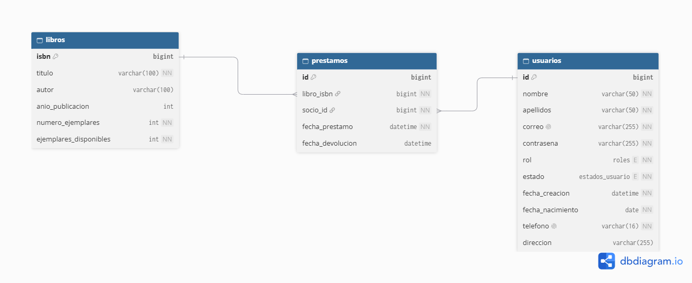

# API Biblioteca (Librería)

API REST con interfaz web para la gestión de una biblioteca: libros, usuarios (socios) y préstamos. Desarrollada con Spring Boot 4 y MySQL.



##  Autor

**Gerardo Yeray Chelius Altamirano |**
7°B de Ingeniería en Sistemas Computacionales

---

## Tecnologías utilizadas

| Tecnología | Versión | Rol |
|---|---|---|
| Java | 21 | Lenguaje principal |
| Spring Boot | 4.1.1 | Framework base |
| Spring Data JPA | — | Capa de persistencia (ORM) |
| Spring Web MVC | — | API REST + controladores de vista |
| Thymeleaf | — | Plantillas HTML (interfaz web) |
| Bean Validation | — | Validación de entidades |
| MySQL | 8+ | Base de datos relacional |
| MySQL Connector/J | — | Driver JDBC |
| Maven | 3.9+ | Gestión de dependencias y build |

---

## Requisitos previos

- **Java 21** instalado y en el `PATH`.
- **MySQL 8+** en ejecución con una base de datos llamada `libreria` creada.
- **Maven 3.9+** (o usar el wrapper `mvnw` incluido).

---

## Variables de entorno

La aplicación lee las credenciales de base de datos desde variables de entorno.  
Crea un archivo **`.env`** en la raíz del proyecto con el siguiente contenido:

```env
DB_URL="jdbc:mysql://localhost:3306/libreria?useSSL=false&serverTimezone=UTC&allowPublicKeyRetrieval=true"
DB_USERNAME="tu_usuario"
DB_PASSWORD="tu_contraseña"
```

> El archivo `.env` **nunca** debe subirse al repositorio. Nunca debe dejarse fuera del `.gitignore`.

| Variable | Descripción |
|---|---|
| `DB_URL` | URL de conexión JDBC a MySQL |
| `DB_USERNAME` | Usuario de la base de datos |
| `DB_PASSWORD` | Contraseña de la base de datos |

---

## Instalación y ejecución

### 1. Clonar el repositorio

```bash
git clone https://github.com/G-Chelius-A/API-Biblioteca
cd API-Biblioteca
```

### 2. Crear la base de datos en MySQL

```sql
CREATE DATABASE libreria;
```

### 3. Configurar las variables de entorno

Crea el archivo `.env` en la raíz del proyecto tal como se indica en la sección anterior.

### 4. Ejecutar la aplicación

**Con Maven Wrapper (recomendado):**

```bash
# Windows
mvnw.cmd spring-boot:run

# macOS / Linux
./mvnw spring-boot:run
```

**Con Maven instalado:**

```bash
mvn spring-boot:run
```

La aplicación se levanta en: **`http://localhost:1500`**

> Al iniciar, Hibernate ejecuta `ddl-auto=update`, por lo que las tablas se crean o actualizan automáticamente si no existen.

---

## Interfaz web

Accede a la interfaz Thymeleaf desde el navegador:

| Ruta | Descripción |
|---|---|
| `http://localhost:1500/` | Vista de libros (página de inicio) |
| `http://localhost:1500/vista/libros` | Gestión de libros |
| `http://localhost:1500/vista/usuarios` | Gestión de usuarios |
| `http://localhost:1500/vista/prestamos` | Gestión de préstamos |

---

## Endpoints de la API REST

### Libros — `/libros`

| Método | Ruta | Descripción | Código de éxito |
|---|---|---|---|
| `GET` | `/libros` | Lista todos los libros | `200 OK` |
| `POST` | `/libros` | Registra un nuevo libro | `201 Created` |
| `GET` | `/libros/{isbn}` | Obtiene un libro por ISBN | `200 OK` |
| `PUT` | `/libros/{isbn}` | Actualiza un libro por ISBN | `200 OK` |
| `DELETE` | `/libros/{isbn}` | Elimina un libro por ISBN | `204 No Content` |
| `GET` | `/libros/autor/{autor}` | Busca libros por nombre de autor | `200 OK` |
| `GET` | `/libros/titulo/{titulo}` | Busca libros por título | `200 OK` |

---

### Usuarios — `/usuarios`

| Método | Ruta | Descripción | Código de éxito |
|---|---|---|---|
| `GET` | `/usuarios` | Lista todos los usuarios | `200 OK` |
| `POST` | `/usuarios` | Registra un nuevo usuario | `201 Created` |
| `GET` | `/usuarios/{id}` | Obtiene un usuario por ID | `200 OK` |
| `PUT` | `/usuarios/{id}` | Actualiza datos personales | `200 OK` |
| `PUT` | `/usuarios/{id}/contrasena` | Actualiza solo la contraseña | `200 OK` |
| `PUT` | `/usuarios/{id}/estado` | Actualiza solo el estado | `200 OK` |
| `PUT` | `/usuarios/{id}/rol` | Actualiza solo el rol | `200 OK` |
| `DELETE` | `/usuarios/{id}` | Elimina un usuario por ID | `204 No Content` |
| `GET` | `/usuarios/nombre/{nombre}` | Busca usuarios por nombre | `200 OK` |
| `GET` | `/usuarios/apellidos/{apellidos}` | Busca usuarios por apellidos | `200 OK` |
| `GET` | `/usuarios/correo/{correo}` | Busca usuarios por correo | `200 OK` |
| `GET` | `/usuarios/estado/{estado}` | Filtra usuarios por estado | `200 OK` |
| `GET` | `/usuarios/rol/{rol}` | Filtra usuarios por rol | `200 OK` |

**Valores válidos para `estado`:** `ACTIVO`, `INACTIVO`, `SUSPENDIDO`  
**Valores válidos para `rol`:** `ADMIN`, `BIBLIOTECARIO`, `LECTOR`

---

### Préstamos — `/prestamos`

| Método | Ruta | Descripción | Código de éxito |
|---|---|---|---|
| `GET` | `/prestamos` | Lista todos los préstamos | `200 OK` |
| `POST` | `/prestamos` | Registra un nuevo préstamo | `201 Created` |
| `GET` | `/prestamos/socio/{socioId}` | Lista préstamos de un socio | `200 OK` |
| `GET` | `/prestamos/libro/{libroIsbn}` | Lista préstamos de un libro | `200 OK` |
| `PUT` | `/prestamos/{id}` | Actualiza libro/socio de un préstamo | `200 OK` |
| `PUT` | `/prestamos/{id}/devolver` | Registra la devolución | `200 OK` |
| `DELETE` | `/prestamos/{id}` | Elimina un préstamo devuelto | `204 No Content` |

---

## Ejemplos de peticiones y respuestas

### Registrar un libro

**`POST /libros`**

```json
// Petición
{
  "titulo": "Fenomenología del espíritu",
  "autor": "Georg Wilhelm Friedrich Hegel",
  "anioPublicacion": 1807,
  "numeroEjemplares": 5
}
```

```json
// Respuesta — 201 Created
{
  "isbn": 1,
  "titulo": "Fenomenología del espíritu",
  "autor": "Georg Wilhelm Friedrich Hegel",
  "anioPublicacion": 1807,
  "numeroEjemplares": 5,
  "ejemplaresDisponibles": 5,
  "prestamo": []
}
```

---

### Actualizar un libro

**`PUT /libros/1`**

```json
// Petición
{
  "titulo": "Fenomenología del espíritu",
  "autor": "Georg Wilhelm Friedrich Hegel",
  "anioPublicacion": 1807,
  "numeroEjemplares": 8,
  "ejemplaresDisponibles": 8
}
```

```json
// Respuesta — 200 OK
{
  "isbn": 1,
  "titulo": "Fenomenología del espíritu",
  "autor": "Georg Wilhelm Friedrich Hegel",
  "anioPublicacion": 1807,
  "numeroEjemplares": 8,
  "ejemplaresDisponibles": 8,
  "prestamo": []
}
```

---

### Registrar un usuario

**`POST /usuarios`**

```json
// Petición
{
  "nombre": "Gerardo Yeray",
  "apellidos": "Chelius Altamirano",
  "correo": "chelius@correo.com",
  "contrasena": "segura123",
  "rol": "LECTOR",
  "estado": "ACTIVO",
  "fechaNacimiento": "2005-05-18",
  "telefono": "+522291234567"
}
```

```json
// Respuesta — 201 Created
{
  "id": 1,
  "nombre": "Gerardo Yeray",
  "apellidos": "Chelius Altamirano",
  "correo": "chelius@correo.com",
  "contrasena": "segura123",
  "rol": "LECTOR",
  "estado": "ACTIVO",
  "fechaCreacion": "2026-10-12T13:00:00",
  "fechaNacimiento": "2005-05-18",
  "telefono": "+522291234567",
  "direccion": null,
  "prestamo": []
}
```

---

### Registrar un préstamo

**`POST /prestamos`**

```json
// Petición
{
  "libro": { "isbn": 1 },
  "socio": { "id": 1 }
}
```

```json
// Respuesta — 201 Created
{
  "id": 1,
  "libro": {
    "isbn": 1,
    "titulo": "Fenomenología del espíritu",
    "autor": "Georg Wilhelm Friedrich Hegel",
    "anioPublicacion": 1807,
    "numeroEjemplares": 8,
    "ejemplaresDisponibles": 7
  },
  "socio": {
    "id": 1,
    "nombre": "Gerardo Yeray",
    "apellidos": "Chelius Altamirano"
  },
  "fechaPrestamo": "2026-10-12T13:05:00",
  "fechaDevolucion": null
}
```

---

### Devolver un préstamo

**`PUT /prestamos/1/devolver`**

```json
// Sin cuerpo en la petición

// Respuesta — 200 OK
{
  "id": 1,
  "libro": {
    "isbn": 1,
    "ejemplaresDisponibles": 8
  },
  "socio": { "id": 1 },
  "fechaPrestamo": "2026-10-12T13:05:00",
  "fechaDevolucion": "2026-10-12T15:30:00"
}
```

---

## Manejo de errores

| Código HTTP | Situación |
|---|---|
| `400 Bad Request` | Datos inválidos o faltantes (ej. sin ejemplares disponibles) |
| `404 Not Found` | Recurso no encontrado (libro, usuario o préstamo) |
| `409 Conflict` | Operación bloqueada por dependencias (ej. préstamos activos) |

---

##  Estructura del proyecto

```
src/main/java/com/api/libreria/
├── controllers/
│   ├── LibroController.java          # API REST — libros
│   ├── UsuarioController.java        # API REST — usuarios
│   ├── PrestamoController.java       # API REST — préstamos
│   ├── LibroVistaController.java     # Vista MVC — libros
│   ├── UsuarioVistaController.java   # Vista MVC — usuarios
│   ├── PrestamoVistaController.java  # Vista MVC — préstamos
│   └── VistaExceptionHandler.java    # Manejador global de excepciones
├── models/
│   ├── LibroModel.java
│   ├── UsuarioModel.java
│   └── PrestamoModel.java
├── repositories/
│   ├── ILibroRepository.java
│   ├── IUsuarioRepository.java
│   └── IPrestamoRepository.java
├── services/
│   ├── LibroService.java
│   ├── UsuarioService.java
│   └── PrestamoService.java
└── utils/
    └── AnioNoFuturo.java
    └── AnioNoFuturoValidator.java
    └── VistaExceptionHelper.java
```

---

> DISCLAIMER: A partir del planteamiento original del proyecto, se potenció con diferentes herramientas generativas sin afectar la lógica original del mismo. Entre estos apartados radican estilos, uso complejo de anotaciones, JavaDocs a escala masiva, etc.
